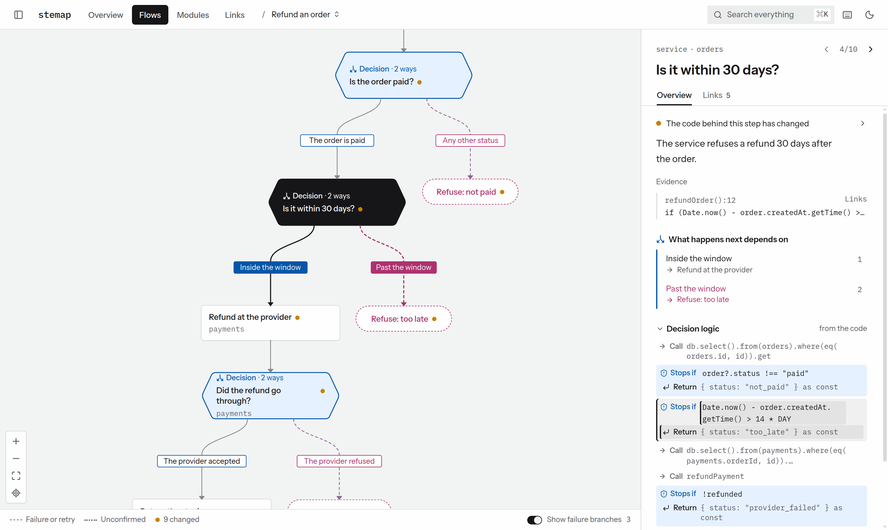
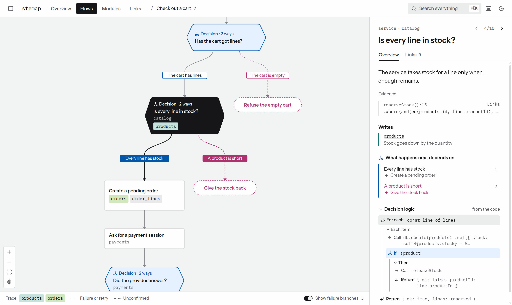
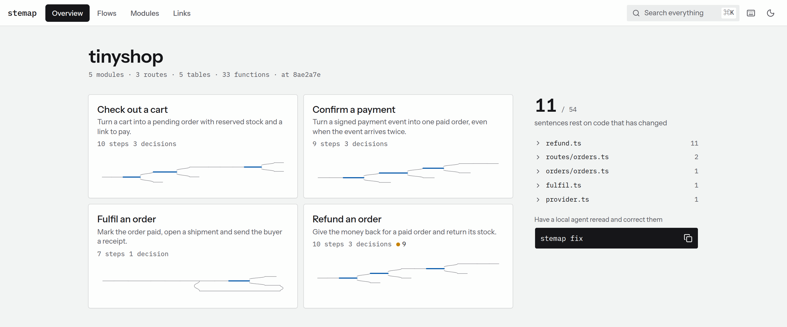

<div align="center">

# stemap

**A map of your code that agents keep true.**

Flows, modules and tables on one page. Every sentence is tied to the code it rests on,<br>
and flagged the moment that code changes.

[](https://github.com/Ice-Hazymoon/stemap/actions/workflows/ci.yml)
[](LICENSE)


</div>

<picture>
  <source media="(prefers-color-scheme: dark)" srcset=".github/assets/refund-dark.png">
  
</picture>

<p align="center"><sub>The map says refunds close after 30 days. The code now says 14, so the sentence is flagged until someone rereads it.</sub></p>

## Why

Code written by agents outgrows what anyone can read, and documentation about it goes stale without a sound. stemap keeps one page where a maintainer can see how things really happen, and it refuses to let a sentence outlive the code behind it.

- **Static.** A plain page that opens from disk. No server, no port, no account.
- **Local.** stemap sends nothing anywhere and calls no model. The agent you already use does the writing, on your own login.
- **Checked.** Facts come from the AST. Sentences are tied to code by a hash, in your editor and in CI.

## Quick start

Run it in any git repository. Node 22 or newer.

```bash
npx stemap         # compile a read-only snapshot of HEAD and open the page
npx stemap init    # add a map and wire up your agents
stemap fill        # have your local agent write the map
```

Functions, calls, routes, pages, tables and queues need no setup. stemap reads Nuxt, Next.js, Hono, Express, Fastify, Drizzle, Prisma and BullMQ, and other JavaScript and TypeScript code still gets its functions, calls and imports.

To see a finished map first, open the example, an invented shop whose code has outgrown one of its sentences:

```bash
git clone https://github.com/Ice-Hazymoon/stemap && cd stemap
bun install && bun run build && bun run demo
```

## What you get

<table>
<tr>
<td width="50%" valign="top">

**Flows.** What happens, step by step, with each decision, failure and table write on the map. Trace one table through a flow, or open a step to read its code.

<picture>
  <source media="(prefers-color-scheme: dark)" srcset=".github/assets/flow-dark.png">
  
</picture>

</td>
<td width="50%" valign="top">

**What moved.** How many sentences the latest code has left behind, and the way to each one. Modules and the links between flows sit one tab away.

<picture>
  <source media="(prefers-color-scheme: dark)" srcset=".github/assets/overview-dark.png">
  
</picture>

</td>
</tr>
</table>

## How a sentence stays true

A sentence in the map is a claim, and each claim quotes the code it rests on:

```yaml
- id: in-window
  title: Is it within 30 days?
  kind: decision
  text: The service refuses a refund 30 days after the order.
  evidence:
    - path: src/orders/refund.ts
      contains: order.createdAt.getTime()
```

`stemap write` finds the function around the quote and locks a hash of what it does. Formatting, comments and moving the function do not change that hash. Change the logic, and the claim is flagged:

```console
$ stemap status
changed  flow/refund/in-window
         The service refuses a refund 30 days after the order.
         src/orders/refund.ts#refundOrder
```

| Status | Meaning | Fix |
| --- | --- | --- |
| `changed` | The function behind the claim changed | Reword it, or `stemap confirm <id> -m "why"` |
| `lost` | The quoted line is gone | Fix the evidence, or `stemap reanchor --apply` |
| `unlocked` | The claim never went through the gate | `stemap write <file>` |
| `edited` | The words changed outside the gate | `stemap write <file>` |

`stemap check` runs the same comparison on a commit, so a local run and a CI run always agree. It also fails on a new route, table or queue that no module owns.

## Your agent, your login

`fill`, `fix` and `review` start the agent program already on your computer: Claude Code, Codex or opencode. API keys never reach it, so a run cannot bill the API.

Each run is locked down. The program starts in an empty folder with no shell, file tools or web. All it can reach is a tool server that reads code through the same secret filter as the page and writes only through the gate. A job counts as done when the map shows the result, not when the agent says so.

Skills, hooks and MCP wiring for Claude Code, Codex and Cursor come with `stemap init`.

## Commands

| Command | Use |
| --- | --- |
| `stemap` | Compile the page and open it. `--out` writes a folder, `--single` one HTML file |
| `stemap init` | Add a map and wire your agents. `--local` keeps it outside the repository |
| `stemap fill` / `fix` / `review` | Have your local agent write the map, resolve drift, or judge a sample |
| `stemap status` | List claims the code no longer backs |
| `stemap check` | Fail if this change left the map behind |
| `stemap write <file>` | Check a document and add it to the map |
| `stemap confirm <id> -m <why>` | Keep a claim after rereading it |
| `stemap context <file>` | Print what to know before editing a file |
| `stemap flow` / `links` / `logic` | Read a flow, an entity's links or a function's decision tree as text |
| `stemap mcp` | Serve map queries to agents over MCP |
| `stemap serve` | Share the page over HTTP, for a browser on another machine |

`stemap --help` lists the rest.

## Limits

- Symbol-level tracking needs JavaScript, TypeScript or Vue. Claims in other languages fall back to a hash of the whole file, so they flag more often.
- The gate proves that a quote exists, not that the sentence is right. Run `stemap review` on a new map.
- A claim rests only on the code it quotes. A change in a function it calls prints a hint and does not block.
- The page shows your source code. `stemap serve` binds to loopback, so pass `--host` only for a network you trust.
- The opencode path follows its documentation and has not run against a real install.

## Develop

```bash
bun install
bun run dev      # Vite with reload, over a compiled page's data
bun run test
bun run build
bun run smoke    # pack, install and drive the tarball under Node
```

The page is React, React Flow and ELK, built into one plain script because a browser refuses modules and wasm files on `file://`. The design rules are in [docs/06-design-system.md](docs/06-design-system.md).

## License

[MIT](LICENSE)
